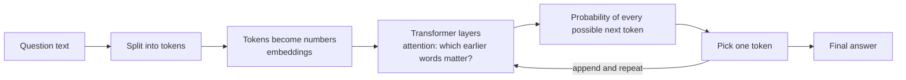

# How LLMs work (in my own words)

A large language model (LLM) is a program that has read a huge amount of text and learned one skill: **given the words so far, guess the next word**. It does this over and over, one small piece of text (a *token*) at a time, until it has written a full answer.

**Key ideas**
- **Tokens**: pieces of words. Cost and speed depend on how many tokens go in and out.
- **Attention**: for every new token the model looks back at earlier tokens and decides which ones matter. This is how "it" gets linked to the right noun.
- **Context window**: the model only "sees" what is in the prompt. It does not look things up by itself.
- **Hallucination**: the model always produces *likely-sounding* text, even when it does not know. For GST, a wrong rate is dangerous.
- **Temperature**: low = steady, repeatable answers (good for rates); high = more creative.

**Why GSTSaral uses RAG (retrieval-augmented generation)**
The model's memory of GST rates may be old or wrong. So GSTSaral first *searches* its own verified records, pastes the best matches into the prompt as numbered sources, and tells the model: answer only from these, cite them, and say "I don't know" if the answer is not there. When two sources conflict, the one with the later date wins.
