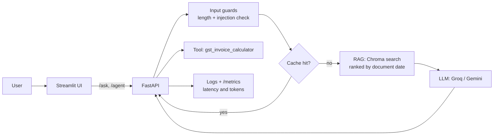

# GSTSaral – GST rules explained, with the latest rule winning


**Live app:** https://gstsaral-ui.onrender.com  
**Live API:** https://gstsaral-api.onrender.com/health  (docs at `/docs`)  
**Demo video:** <paste your video link>

> Free Render services sleep after about 15 minutes. The first request can take around a minute.

## Problem

Shopkeepers and small businesses get confused by GST: old 2017–18 FAQs still show outdated limits,
while the 2025–26 Council changes moved many everyday items to new rates. GSTSaral answers
questions from official GST Council documents, shows which document and date each answer
comes from, and warns when an older FAQ has been replaced by a newer rule. Invoice amounts are
computed by code, not guessed by the LLM.

## Architecture



## Results

| Test | Config A | Config B | Winner |
|---|---|---|---|
| Eval set (15 questions), correct + cited | <chunk size / top-k from Day 8> | <chunk size / top-k from Day 8> | <fill in> |
| Q6 "I don't know" case | pass / fail | pass / fail | <fill in> |

## Production notes

Numbers below come from `python scripts/bench.py <url>` against the deployed API on <date>.

| Metric | Value |
|---|---|
| Uncached median latency | <fill from bench.py> |
| Uncached p95 latency | <fill from bench.py> |
| Cached median latency | <fill from bench.py> |
| Tokens per answered question (prompt / completion) | <fill from /metrics> |
| Cache hit rate in the benchmark | <fill from bench.py> |

What is in place:

- **Logging:** every request logs one JSON line (path, status, latency, prompt tokens, completion tokens, cache hit). `GET /metrics` shows p50, p95, token totals and cache hit rate.
- **Cache:** in-memory TTL cache (10 minutes, 256 entries). Same question with different case or spacing hits the same entry.
- **Input limits:** questions over 500 characters or empty questions return HTTP 422. The LLM call also has a `max_tokens` limit.
- **Prompt-injection check:** messages such as "ignore all previous instructions" return HTTP 400 before reaching retrieval or the LLM. Covered by `tests/test_day13.py`.
- **Known limits:** the cache is per instance and is lost on restart. The injection check is pattern-based, so it will not catch every attack.

## Run with Docker

```bash
cp .env.example .env      # add your GROQ_API_KEY or GEMINI_API_KEY
docker compose up --build
# API: http://localhost:8000/docs   UI: http://localhost:8501
```

## CI

GitHub Actions runs `ruff check .`, `pytest` and `docker build` on every push and pull request to `main`.
