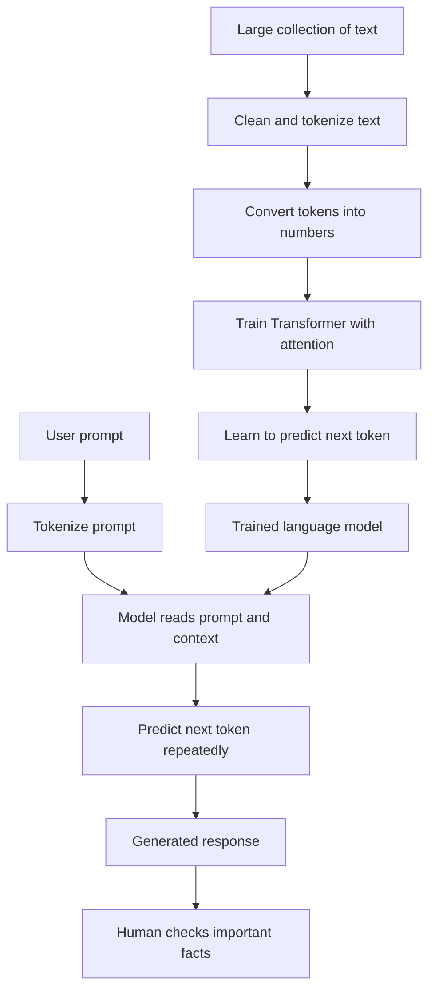

# How Large Language Models (LLMs) Work

A Large Language Model (LLM) is an AI system trained on a very large collection of text. During training, it learns patterns in language, such as which words and ideas commonly appear together. It does not store a perfect copy of every source and it can still make mistakes.

## Main steps

1. **Collect and prepare text:** Training text is gathered, cleaned and converted into smaller pieces called tokens. A token can be a word, part of a word or punctuation.
2. **Convert tokens into numbers:** The model turns tokens into numerical representations so that a neural network can process them.
3. **Learn patterns during training:** A Transformer model uses attention to work out which parts of the context are important. It repeatedly adjusts its internal parameters while learning to predict the next token in training examples.
4. **Generate an answer:** When a user sends a prompt, the prompt is tokenized and passed into the trained model. The model predicts a likely next token, adds it to the context and repeats this process to build a response.
5. **Review the result:** The generated response should be checked, especially for facts, calculations, dates and legal or tax information. An LLM can produce a confident answer that is incorrect.

## Simple LLM workflow

## How this relates to GSTSaral

GSTSaral currently uses a smaller and simpler retrieval approach, TF-IDF with cosine similarity, to find matching GST records. It is **not an LLM** and it does not generate answers from broad language knowledge. Its `/questions` endpoint finds the closest matching record and formats the stored rate-change details into a response. This keeps the response connected to the available records, but it also means a question about information missing from the dataset cannot be answered reliably.

For GST compliance, always verify the applicable notification, HSN classification and conditions from official sources. A language model or a similarity search result is not a substitute for official tax advice.
